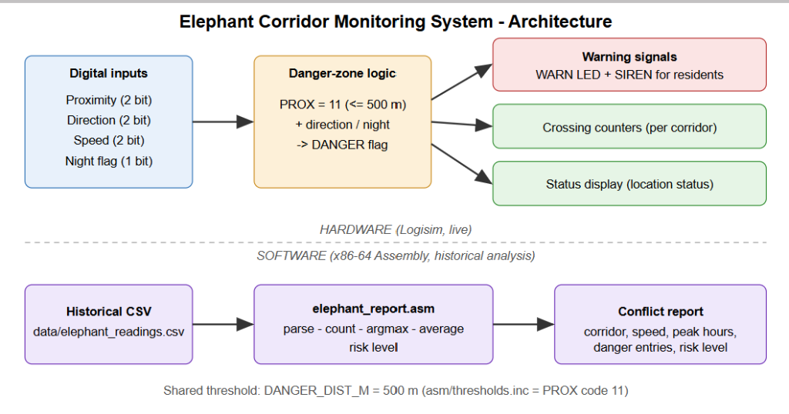

# Elephant Corridor Monitoring System

**Project 9 - PCS course**

| # | Name          | Roll No.     |
| - | ------------- | ------------ |
| 1 | Koushal Reddy.V | B25CM1062 |
| 2 | R Trupti | B25CM1037 |
| 3 | Sreehari EH | B25CM1052 |
| 4 | K.Amuktha Malyadha | B25CM1029 |
| 5 | Amratanshu Gupta | B25CM1006 |
| 6 | Chhichhia Het Rajesh | B25CM1011 |

## 1. Introduction

Human-elephant conflict is a serious problem where settlements border forest corridors. Elephants entering villages cause crop damage, property loss and casualties. This project designs a simplified digital early-warning system that monitors elephant movement, warns residents when an elephant enters a danger zone, counts corridor crossings, and analyses historical movement data to support management decisions.

## 2. Objectives

1. Represent proximity, direction, speed and time of day as digital inputs.
2. Detect entry into a predefined danger zone.
3. Generate warning signals for residents.
4. Count corridor crossings and display the current status.
5. Analyse historical data in x86-64 Assembly: most used corridor, average and maximum speed, peak activity periods, and a conflict report.

## 3. System architecture



See `docs/architecture.svg` and `docs/architecture.png`. The **hardware part** (Logisim) works live; the **software part** (Assembly) works on recorded data. Both share the threshold `DANGER_DIST_M = 500 m`.

## 4. Digital representation of inputs

| Signal      | Bits | Encoding                                              |
| ----------- | ---- | ----------------------------------------------------- |
| Proximity   | 2    | 11 <=500 m, 10 501-1000 m, 01 1001-2000 m, 00 >2000 m |
| Direction   | 2    | 00 away, 01 toward, 10 parallel                       |
| Speed       | 2    | 00 <3, 01 3-6, 10 7-12, 11 >12 km/h                   |
| Time of day | 1    | 1 = night (18:00-05:59)                               |
| Corridor    | 2    | A-D (00=A, 01=B, 10=C, 11=D)                          |

## 5. Hardware design (Logisim)

Logic:

- `DANGER = (PROX == 11)`
- `WARN_LED = DANGER + (PROX == 10 . DIR == toward)`
- `SIREN = DANGER . (DIR == toward + NIGHT)`
- One counter per corridor, clocked by the rising edge of DANGER and enabled by the decoded corridor.
- A status display shows CLEAR / NEAR / ALERT / DANGER.

*(Add screenshots of the Logisim circuit here and a sentence on each sub-circuit: input stage, danger detector, warning logic, counters, display. Expected truth table: `circuit/elephant_vectors.txt`.)*

## 6. Software design (Assembly)

**Input:** CSV `id,corridor,hour,speed_kmh,distance_m,direction`. **Algorithm:**

1. Open and read the file with Linux syscalls.
2. Skip the header; parse six numbers per row with a digit-accumulation routine.
3. Validate corridor (0-3) and hour (0-23).
4. Update counters: per corridor, per hour, per 6-hour period; speed sum and maximum; danger-zone entries (total, per corridor, night).
5. Find maxima with an `argmax` routine.
6. Compute average speed = sum / count (one decimal via remainder).
7. Risk level from the percentage of readings inside the danger zone: >=30 % HIGH, >=10 % MEDIUM, otherwise LOW.
8. Print the formatted report with the `write` syscall.

**Files:** `asm/elephant_report.asm`, `asm/thresholds.inc`.

## 7. Verification

`tools/reference.py` re-implements the analysis in Python. `make check` assembles the program, runs it on both datasets and diffs against the Python output: **PASS** on `elephant_readings.csv` (120 readings, high activity) and `elephant_quiet.csv` (8 readings, low activity). The circuit is checked against the truth table in `circuit/elephant_vectors.txt`.

## 8. Results (120 readings)

| Metric                  | Value                                                          |
| ----------------------- | -------------------------------------------------------------- |
| Most used corridor      | B (53 crossings)                                               |
| Crossings A / B / C / D | 33 / 53 / 6 / 28                                               |
| Average speed           | 5.9 km/h                                                       |
| Maximum speed           | 20 km/h                                                        |
| Peak activity hour      | 22:00-22:59 (13 readings)                                      |
| Peak period             | Evening (18-24)                                                |
| Danger-zone entries     | 21 (17 %), 20 at night                                         |
| Risk level              | MEDIUM - sound siren at night, restrict movement near corridor |

The full output is in `out/conflict_report.txt`.

## 9. Case study discussion

Corridor B carries 44 % of all crossings and almost half of the danger-zone entries (10 of 21), so it is the priority location for sirens, early-warning posts and patrols. Almost all danger entries (20 of 21) occur between 18:00 and 06:00, so residents should be warned in the evening and night shifts of the forest department should be strengthened. The maximum speed of 20 km/h indicates occasional charging events, which justify the faster siren response in the circuit.

## 10. Limitations and future work

- Data is synthetic; real data would come from GPS collars, camera traps or PIR/ultrasonic sensors.
- Integer arithmetic only; direction is recorded but not used in the software risk level.
- Fixed 16 KB input buffer.
- Future: more corridors, weighted risk score, SMS alerts, dynamic buffer.

## 11. Conclusion

The system covers the full pipeline: digital representation, danger detection, warnings, counting and display in hardware, and statistical conflict analysis in Assembly. The software was verified against an independent model, and both halves share one danger threshold.

## 12. How to run

```bash
make        # build
make run    # report -> out/conflict_report.txt
make check  # verification
```
